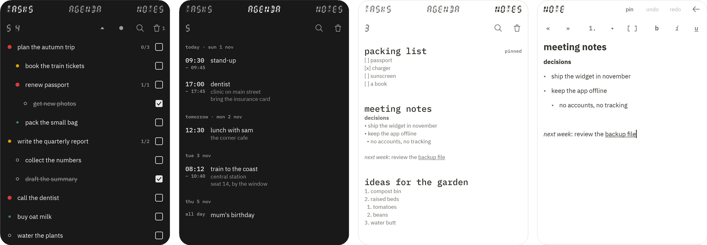

  

  <code>android</code> <code>kotlin</code> <code>jetpack compose</code> <code>offline</code> <code>agpl-3.0</code>

  

planner is a task list, an agenda and a notebook for android, in one small app that keeps everything on your phone. there is no account, no sync service and no internet permission at all.

it started as a quick standalone trial and turned out to be useful on its own, so it is kept up. it is not part of any larger set of apps.

### what it does

**tasks.** subtasks up to four levels deep, a priority on every task (none, low, medium, high), a bin for anything you remove, and two orders: your own, or ranked by priority. checking a task covers everything inside it.

**agenda.** your events soonest first, grouped by day, with the time, the place and the notes in view. an event can be all day, have a start, or have a start and an end, and it can remind you: at the time, 10 minutes before or an hour before.

**notes.** a title, then plain text you can mark up: bulleted and numbered lists, checkboxes, indent, bold, italic and underline, with undo and redo. notes are kept in the order you put them, can be pinned, and have a bin of their own.

**around them.** one search over all three, a widget with today's events and your open tasks, shortcuts on the app icon for a new task, event or note, text shared from other apps becomes a note, and a backup you can save to a file or have written to a folder every day.

### install

download the apk from the [latest release](https://github.com/fourthbreakfast/planner/releases/latest) and open it on your phone. you need android 8 or newer, and your phone will ask you to allow installing it. updates install over the top and keep your data.

### use

everything a row can do starts with holding it for a moment, so sweeping across the screen never removes anything by accident. the settings (hold any of the three tabs) have a "how it works" list of every gesture.

<table>
  <tr><th colspan="2">tasks</th></tr>
  <tr><td>touch a task</td><td>open or close its subtasks</td></tr>
  <tr><td>touch a task while typing</td><td>add the new task inside it</td></tr>
  <tr><td>touch the dot on a task</td><td>change its priority</td></tr>
  <tr><td>hold, then swipe right</td><td>move it to the bin, with undo</td></tr>
  <tr><td>hold, then swipe left</td><td>rename it</td></tr>
  <tr><td>hold, then drag</td><td>move it: onto the middle of a task puts it inside at the end, onto a line puts it just above the task under the line. in priority order it snaps back among its own colour</td></tr>
  <tr><td>the dot at the top</td><td>switch between your own order (grey) and priority order (red)</td></tr>
  <tr><td>the triangle at the top</td><td>open or close everything</td></tr>
  <tr><th colspan="2">agenda</th></tr>
  <tr><td>plus at the bottom right</td><td>add an event</td></tr>
  <tr><td>touch an event</td><td>edit it</td></tr>
  <tr><td>hold an event, then swipe right</td><td>move it to the agenda's bin, with undo</td></tr>
  <tr><th colspan="2">notes</th></tr>
  <tr><td>plus at the bottom right</td><td>add a note and start writing</td></tr>
  <tr><td>touch a note</td><td>write in it; the row at the top sets pull out, push in, numbered list, bulleted list, checkbox, bold, italic and underline, and enter ends an empty list item</td></tr>
  <tr><td>hold a note, then drag</td><td>put it somewhere else in the list</td></tr>
  <tr><td>hold a note, then swipe right</td><td>move it to the notes bin, with undo</td></tr>
  <tr><th colspan="2">everywhere</th></tr>
  <tr><td>sweep sideways</td><td>go to the next tab: tasks, agenda, notes. it stops at the ends</td></tr>
  <tr><td>hold any tab</td><td>open the settings: export and import, theme, a daily backup to a folder, where the notes toolbar sits, a link to the latest release, the widget, and the list of gestures</td></tr>
  <tr><td>the magnifying glass</td><td>search the tasks, the agenda and the notes at once</td></tr>
  <tr><td>hold the app icon</td><td>new task, new event or new note, straight away</td></tr>
  <tr><td>a reminder notification</td><td>touch it to open the event, or snooze it for 10 minutes</td></tr>
</table>

### privacy

everything lives in a database on your phone. planner asks for no internet permission, so it cannot send anything anywhere. the only permissions it uses are the ones reminders need: showing notifications, setting exact alarms, and setting them again after a restart.

a backup is a plain json file you can read and keep. importing one only adds what is missing, never changes or removes what you have, so importing the same file twice is harmless.

### build

planner is written in kotlin with jetpack compose, and stores its data with room. to build it, open the `android` folder in android studio and press run, or use `gradlew installDebug` with a phone connected. the pinned tool versions and the structure of the code are in [android/README.md](android/README.md), and the look is documented in the [design system](docs/design-system).

`gradlew installDebug -Pdemo` installs a second copy called "planner dev" with its own empty data, so a change can be tried without touching the real app.

### credits

the fonts are [ibm plex sans](https://github.com/IBM/plex) and [ibm plex mono](https://github.com/IBM/plex), under the SIL open font license ([docs/licenses/IBMPlex-OFL.txt](docs/licenses/IBMPlex-OFL.txt)). the calculator-style lettering is drawn in code, not a font.

### license

[agpl-3.0](LICENSE)
