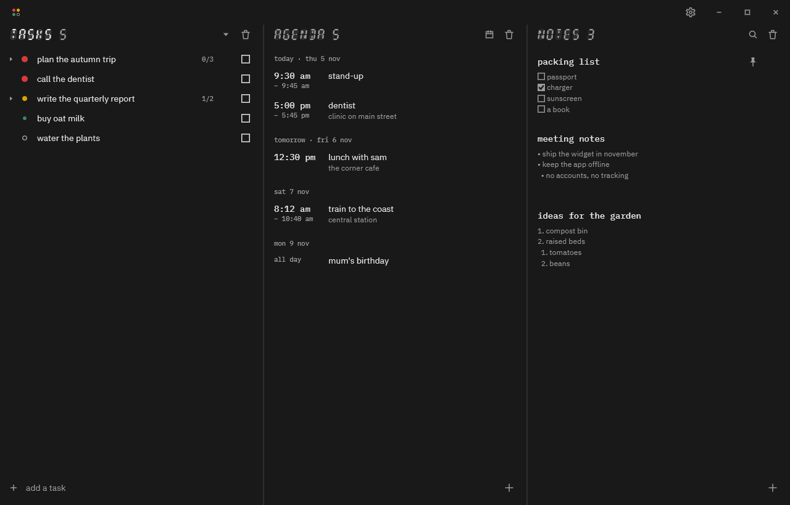

  

  <code>android</code> <code>windows</code> <code>kotlin</code> <code>jetpack compose</code> <code>no account</code> <code>agpl-3.0</code>

  

planner is a task list, an agenda and a notebook for android and windows, in one small app that keeps everything on your own devices. there is no account and no server: it can sync between your devices by itself, with a private copy of syncthing built in.

it started as a quick standalone trial and turned out to be useful on its own, so it is kept up. it is not part of any larger set of apps.

### what it does

**tasks.** subtasks up to four levels deep, a priority on every task (none, low, medium, high), a bin for anything you remove, and every level ranked by priority. checking a task covers everything inside it, and tasks with subtasks start closed.

**agenda.** your events soonest first, grouped by day, with the time, the place and the notes in view. an event can be all day, have a start, or have a start and an end, last several days, repeat by day, week, month or year, and remind you: at the time, 10 minutes before or an hour before. events from other calendars come in from an .ics file. the agenda can also show a month, with a dot on every day that has something on it.

**notes.** a title, then plain text you can mark up: bulleted and numbered lists, checkboxes, indent, bold, italic and underline, with undo and redo. notes are kept in the order you put them, can be pinned, and have a bin of their own.

**around them.** a search of the notes, a widget with today's events and your open tasks, shortcuts on the app icon for a new task, event or note, text shared from other apps becomes a note, and a backup you can save to a file or have written to a folder every day.

**sync.** pair your devices from the settings by scanning or typing a code, and they keep each other up to date. it runs while the app is open and every quarter of an hour or so in the background. the newest change wins, and a note changed on two devices before they met keeps the older words in its bin.

### install

the [latest release](https://github.com/fourthbreakfast/planner/releases/latest) has both.

**phone.** download the apk and open it on your phone. you need android 8 or newer, and your phone will ask you to allow installing it. updates install over the top and keep your data.

**verify.** the apk is signed with one key for every release, whose SHA-256 certificate digest is `619dc72c00a929a10ec1da3e81ecec0062437f8a28e4263610655e4190d670db`. check it with `apksigner verify --print-certs planner-1.0.0.apk`.

**updates.** both apps look for a newer release once a day and offer it in the settings (and on windows beside the settings cog in the title bar); one touch downloads it and starts the installer. the daily look can be turned off.

**windows.** download the setup and run it. it installs for you alone, needs no administrator, and puts planner in the start menu. windows 11 or 10, 64 bit. the installer is not signed, so windows may warn the first time: "more info", then "run anyway". the first time sync runs, the windows firewall asks whether planner may use the network: allow it on private networks, or your phone cannot reach it. updates install over the top and keep your data.

### use

everything a row can do starts with holding it for a moment, so sweeping across the screen never removes anything by accident. the settings (the cog at the top right, or hold any of the three tabs) have a "how it works" list of every gesture.

<table>
  <tr><th colspan="2">tasks</th></tr>
  <tr><td>touch a task</td><td>open or close its subtasks</td></tr>
  <tr><td>touch a task while typing</td><td>add the new task inside it</td></tr>
  <tr><td>touch the dot on a task</td><td>change its priority</td></tr>
  <tr><td>hold, then swipe right</td><td>move it to the bin, with undo</td></tr>
  <tr><td>hold, then swipe left</td><td>rename it</td></tr>
  <tr><td>hold, then drag</td><td>move it: onto the middle of a task puts it inside at the end, onto a line puts it just above the task under the line. it then snaps back among its own colour</td></tr>
  <tr><td>the triangle at the top</td><td>open or close everything</td></tr>
  <tr><th colspan="2">agenda</th></tr>
  <tr><td>plus at the bottom right</td><td>add an event</td></tr>
  <tr><td>touch an event</td><td>edit it</td></tr>
  <tr><td>the grid icon at the top</td><td>switch between the list and the month; in the month, touch a day to see its events, and the arrows change the month</td></tr>
  <tr><td>hold an event, then swipe right</td><td>move it to the agenda's bin, with undo</td></tr>
  <tr><th colspan="2">notes</th></tr>
  <tr><td>plus at the bottom right</td><td>add a note and start writing</td></tr>
  <tr><td>touch a note</td><td>write in it; the row at the top sets pull out, push in, numbered list, bulleted list, checkbox, bold, italic and underline, enter makes a new line, two make a new paragraph or end a list, and a selection can run across lines</td></tr>
  <tr><td>hold a note, then drag</td><td>put it somewhere else in the list</td></tr>
  <tr><td>hold a note, then swipe right</td><td>move it to the notes bin, with undo</td></tr>
  <tr><td>hold a note, then swipe left</td><td>copy all of it as text, without opening it</td></tr>
  <tr><td>the pin at the top right of a note</td><td>pin it to the top of the list (a filled pin means pinned)</td></tr>
  <tr><th colspan="2">everywhere</th></tr>
  <tr><td>sweep sideways</td><td>go to the next tab: tasks, agenda, notes. it stops at the ends</td></tr>
  <tr><td>the cog at the top right, or hold any tab</td><td>open the settings: export and import, theme, a daily backup to a folder, where the notes toolbar sits, a link to the latest release, the widget, sync, and the list of gestures</td></tr>
  <tr><td>hold the bin</td><td>empty that bin for good, after asking once</td></tr>
  <tr><td>the magnifying glass beside the bin, on the notes tab</td><td>search the notes by title and text</td></tr>
  <tr><td>hold the app icon</td><td>new task, new event or new note, straight away</td></tr>
  <tr><td>a reminder notification</td><td>touch it to open the event, snooze it for 10 minutes or dismiss it</td></tr>
</table>

### on windows

  

the window shows the tasks, the agenda and the notes side by side. a note, an event, a bin, the search or the settings slide in from the right, and escape closes them. the cog in the title bar opens the settings, which also have the list of shortcuts.

<table>
  <tr><td>ctrl+1, ctrl+2, ctrl+3</td><td>go to tasks, agenda or notes</td></tr>
  <tr><td>ctrl+n</td><td>a new task, event or note, in the part you are in</td></tr>
  <tr><td>up, down, enter</td><td>choose a task, an event or a note, and open it</td></tr>
  <tr><td>f2 or a double click</td><td>rename a task</td></tr>
  <tr><td>space, delete</td><td>check a task, or move what is chosen to the bin</td></tr>
  <tr><td>ctrl+f, ctrl+,</td><td>search the notes, open the settings</td></tr>
  <tr><td>a right click</td><td>everything else a row can do: rename, priority, a task inside, pin, copy a note, bin. the pin and bin also show beside a note when the pointer is over it, and holding the bin empties it</td></tr>
  <tr><td>drag</td><td>a task onto another to put it inside or beside, a note to reorder, an event onto a day of the month</td></tr>
  <tr><td>closing the window</td><td>keeps planner in the tray, so reminders and sync go on. quit from the tray, or have it start with windows in the settings</td></tr>
</table>

### privacy

everything lives in a database on your device, and nothing is sent anywhere unless you pair another device. sync runs through the app's own copy of syncthing, with its own keys, ports and folder, separate from any syncthing you run yourself. it only looks for your devices on the network you are on: no discovery servers, no relays, no usage or crash reports. "sync anywhere" in the sync settings lets it reach your devices from other networks too, through syncthing's public discovery and relay servers; what travels is end to end encrypted, but those servers see your device's id and address.

the daily update check is the one other thing that goes out: it asks github for the latest release page, and sends nothing about you. it can be turned off in the settings.

planner asks for network access for sync, and for the permissions reminders need: showing notifications, setting exact alarms, and setting them again after a restart. it asks for the camera only when you scan a code to pair.

a backup is a plain json file you can read and keep. importing one only adds what is missing, never changes or removes what you have, so importing the same file twice is harmless.

### build

planner is written in kotlin with compose multiplatform, and stores its data with room. the phone and windows apps share their data, rules, sync, words and parts of the screens; each has a layout of its own. the sync is [syncthing](https://syncthing.net), pinned as a submodule in [third_party/syncthing](third_party/syncthing) and built from source with go, so clone with `--recurse-submodules` and have go installed (the build fetches the exact go version syncthing asks for). to build it, open the `android` folder in android studio and press run, or use `gradlew installDebug` with a phone connected. the pinned tool versions and the structure of the code are in [android/README.md](android/README.md), and the look is documented in the [design system](docs/design-system).

`gradlew installDebug -Pdemo` installs a second copy called "planner dev" with its own empty data, so a change can be tried without touching the real app.

the windows app runs with `gradlew :desktop:run`, and `gradlew :desktop:packageSetup` builds its installer (it needs [inno setup 6](https://jrsoftware.org/isinfo.php)). set `PLANNER_DATA` to a folder, and `PLANNER_PREFS` to a name, to try it on data and settings other than your own.

### credits

the fonts are [ibm plex sans](https://github.com/IBM/plex) and [ibm plex mono](https://github.com/IBM/plex), under the SIL open font license ([docs/licenses/IBMPlex-OFL.txt](docs/licenses/IBMPlex-OFL.txt)). the calculator-style lettering is drawn in code, not a font.

sync is [syncthing](https://syncthing.net) by the syncthing contributors, under the mozilla public license 2.0 ([docs/licenses/Syncthing-MPL-2.0.txt](docs/licenses/Syncthing-MPL-2.0.txt)); its source is in [third_party/syncthing](third_party/syncthing), unchanged. the pairing codes are read and drawn with [zxing](https://github.com/zxing/zxing) and [zxing android embedded](https://github.com/journeyapps/zxing-android-embedded), under the apache license 2.0 ([docs/licenses/Apache-2.0.txt](docs/licenses/Apache-2.0.txt)).

### license

[agpl-3.0](LICENSE)
