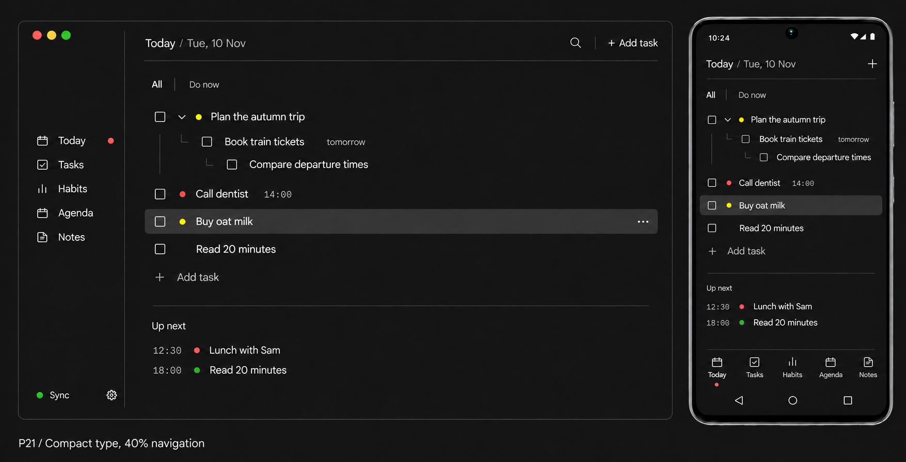

# Planner design system

Version 1.0 · Planner 2.0 · 11 November 2026

Latest visual reference: [P24, with the cog artifact corrected](references/p24.png). The navigation placement rule below supersedes P21's 40% rule. The page header now reads Today alone, at content size; no slash/date suffix. Generated images illustrate the direction; exact placement follows the written formula.

This is the shared design reference for the whole Planner project: Android, Windows, Linux, widgets, settings, editors, documentation imagery and future features. It describes the intended direction, not a claim that the current application already implements it.



## Authority and decision status

Use this document and the approved P21 composition as the current visual source of truth. The latest explicit user decision takes precedence. Written rules take precedence over accidental details in a generated image.

- **Approved**: explicitly chosen in the design discussion. Implement consistently.
- **Proposed**: a concrete specification derived from the direction, awaiting visual review. Do not present it as an approved brand rule.
- **Open**: not established yet. Reuse an applicable approved pattern; otherwise document and decide a pattern before treating it as standard.

P21 is a visual reference, not a source of exact pixel measurements. Generated typography, window decorations, alignment and icon details can be inconsistent. In particular, its oversized page label is superseded by the equal-size typography decision below.

The [older system](legacy-pre-p21.md) and component HTML previews are historical. `tokens.json` now mirrors the 2.0 runtime palette and sizes. Updated component notes describe the new controls; remaining historical previews do not override this document.

## 1. Product character — approved

A plain task document made comfortable to use. Professional, modern, productive and efficient, with restrained color and a clear identity.

Text and user content lead. Hierarchy comes from alignment, spacing, weight and emphasis. Controls support the content. Preserve the directness of Markdown and CLI tools without displaying command syntax where a normal control is clearer.

Avoid slogans, promotional headings, oversized page titles, persistent logo headers, decorative dashboard cards and ornamental shapes. Avoid both an industrial hardware aesthetic and a generic black-and-blue dashboard. Empty space must improve reading and grouping rather than merely enlarge the interface.

These principles guide new screens; they do not require every screen to copy the Today layout.

## 2. Identity and language

**Approved:** the app is Planner. Do not reserve a large logo/wordmark area inside the everyday workspace. Small functional colored dots are part of its visual vocabulary.

**Open:** final logo, app icon, wordmark construction, clear space, minimum size, alternate lockups, marketing imagery and voice outside the product. The mockup's desktop traffic-light buttons are not a Planner brand asset and must not replace native Windows/Linux controls.

**Proposed product copy:** concise, concrete sentence case: “Add task”, “Up next”, “Sync now”. Preserve user-entered wording and capitalization. No motivational slogans. Empty states explain the next useful action in one sentence. Error messages explain what happened and how to recover, without exposing internal implementation details.

## 3. Color

### Approved direction

One continuous neutral graphite background across desktop sidebar and content. No reddish/brown warmth or pronounced two-tone shell. Clean off-white main text, gray metadata, restrained red/yellow/green accents. No blue as a default brand accent.

Use circular dots for priority/status accents instead of decorative diamonds, squares or flags. Functional square checkboxes remain square controls.

Color cannot be the only way to understand an actionable state: provide visible labels where needed, accessible names, selected semantics and text in tooltips/details. A screen-reader label alone does not help a sighted user distinguish ambiguous dots.

### Proposed initial tokens

These are deliberate implementation starting values, not colors sampled or approved pixel-for-pixel from P21.

| Role | Value | Use |
| --- | --- | --- |
| background | #171719 | Sidebar and main canvas |
| surface | #202023 | Menus, editors and necessary overlays |
| hover | #262629 | Quiet pointer feedback |
| selected | #2D2D31 | Selected/active row |
| text.primary | #E8E8ED | Task content and active labels |
| text.secondary | #AAAAB3 | Dates, metadata, inactive navigation |
| divider | #3D3D43 | Quiet structural lines; not control focus |
| control.outline | #85858F | Checkbox and control boundaries |
| accent.red | #EF6662 | High priority / attention |
| accent.yellow | #E4C452 | Medium priority / shortlist marker |
| accent.green | #79BF88 | Low priority / successful sync |
| focus | #E8E8ED | Visible neutral keyboard outline |

Validate text and control contrast in the actual renderer, including disabled and selected states. Do not use the quiet divider color as the only essential control boundary.

**Open:** exact accent values, destructive-action treatment, warning versus priority semantics, selected-text palette and light theme. Do not infer a complete light theme by inverting the dark tokens.

## 4. Typography

### Approved

- Compact task text using P10's scale within P21's composition.
- The “Today / Tue, 10 Nov” page/date line uses **the same font size as task content**.
- “Today” may use slightly more weight; the date uses secondary text color. No heading size jump.
- **Approved header:** “Today” alone, without the slash/date suffix. Dates appear in task metadata and the agenda. Page labels and task content share the same type size.
- Quiet, smaller metadata. Readable neutral sans for ordinary UI; numeric times align consistently.
- No segmented display headings. No oversized branding or page titles.

### Proposed type roles

Sizes are logical sp, not screenshot pixels. Respect platform/user font scaling.

| Role | Size / line height | Weight |
| --- | --- | --- |
| Content and page/date label | 16 / 24 | 400; page name may be 500 |
| Navigation and actions | 15 / 22 | 400; active may be 500 |
| Metadata and time | 13 / 20 | 400 |
| Section label, e.g. Up next | 14 / 20 | 400–500 |

One modest type family, a small number of weights, no arbitrary per-screen size changes. Prefer tabular numerals for times; use a separate monospace face only if reviewed and useful.

**Open:** exact font family, bundled weights and licensing, and how the earlier request for programming ligatures is served. Do not silently choose a programming font for all interface text or alter stored text to simulate ligatures.

## 5. Layout and spacing

### Approved desktop composition

- Sidebar navigation order: **Today → Tasks → Habits → Agenda → Notes**.
- Navigation group midpoint: **halfway between the horizontal divider below the page header and the divider above Up next**. This supersedes the full-window 40% rule.
- Sync and settings remain bottom-anchored, separate from the navigation group.
- A compact page/date toolbar, All / Do now control, document-like nested task list, and quiet Up next section below.
- Unified background. Modest rounding on window and row selections.
- P15-style subtle inset separators, not an edge-to-edge spreadsheet frame.
- No return to three equally prominent Tasks/Agenda/Notes dashboard columns.

Placement rule:

```text
panelCenter = (headerDividerY + upNextDividerY) / 2
desiredGroupTop = panelCenter - navigationGroupHeight / 2
groupTop = clamp(desiredGroupTop, safeTop, footerTop - groupHeight - safeGap)
```

On a short window where the group cannot fit between safe bounds, allow the navigation region to scroll or adapt the shell; never overlap footer actions. Center the whole five-item group, not its first item. This is a panel-relative layout constraint, not a hardcoded image coordinate. Its application outside Today remains an open responsive-shell decision.

### Proposed spacing scale

Use 4, 8, 12, 16, 24 and 32 logical dp. Initial values: desktop content gutter 24–32, phone gutter 16, task indent 20 per level, desktop row minimum 36–40, touch row minimum 48. Let long content wrap and height grow.

Divider rules: one thin sidebar line runs continuously from the top of the desktop title bar to the bottom of the window. Horizontal toolbar and Up next dividers remain inset, align with the content gutter and stop before panel edges. No border around each task. No connected grid intersections. Keep structural dividers quieter than task content.

Small selection radius: 4dp proposed. Outer window shape follows platform support. Do not force a square or custom-decorated desktop frame.

### Approved mobile direction

Same text-first identity and destination order. Compact page/date header, clear add action, quiet filter, nested tasks, Up next and labeled bottom navigation. Drawings can be small; touch targets remain generous.

**Open:** breakpoint values, narrow desktop navigation, landscape/tablet adaptations, sidebar collapse behavior and dense/deep nesting treatment. Determine these with representative content and font scaling, not device names.

## 6. Component contracts

| Component | Approved direction | Details still to settle |
| --- | --- | --- |
| Task row | Text-led, compact, tidy indentation, metadata secondary; no individual card borders | Exact padding, wrapping, selected/hover states |
| Checkbox | Fine square outline, subtle corners, clean tick; Notion-like simplicity | Mixed parent state, checked fill and stroke dimensions |
| Disclosure | Small chevron; faint hierarchy guides | Exact click region and expand/collapse semantics |
| Priority | Red/yellow/green dot, small and restrained | Exact diameter and none-state treatment |
| Do now | Saved shortlist plus isolated shortlist view | Distinguish its yellow marker from medium priority |
| Row actions | Quiet ellipsis on desktop hover/focus; discoverable on touch | Menu contents, keyboard entry and touch placement |
| Navigation | Modest labels/icons, active emphasis, order above | Exact icon family and active-dot placement |
| Add action | One inline Add task action below the task list; remove duplicate top-right add control | Keyboard shortcut presentation |
| Up next | Quiet time-led agenda summary below task document | Horizon, maximum entries, no-time events |
| Sync | Small status indicator near settings/footer | Multi-device, stale, offline and error presentation |
| Bullet/list marker | Small, restrained, aligned with text | Exact marker, gutter and nesting rules in notes |

Do not map two different actions to indistinguishable dots in one context. P21 illustrates both priority and shortlist but does not resolve that interaction. This is a decision to make explicitly before implementing those markers together.

## 7. Applying the system across the product

P21 approves a direction for Today and the shared shell, not finished designs for every feature. All other areas inherit typography, spacing, neutral surfaces and restrained controls.

| Area | Preserve existing functionality | Next design work |
| --- | --- | --- |
| Today | Task completion, nesting, scheduling and shortlist | Empty, long, completed and error states |
| Tasks | Hierarchy, priorities, ordering, bins, add/rename | Dense list, drag depth/insertion, parent states |
| Habits | Separate section, scheduled weekdays, history, streaks, archive | Weekly history, missed/rest days, editor |
| Agenda | Monday first, no-time items, recurrence, task scheduling, subscriptions | Day/week/month views and event editor |
| Notes | Rich/plain text, multiline lists/checklists, pinning, autosave | Editor toolbar, selection, list indentation |
| Settings | Sync now, devices, backup, updates, preferences | Grouping, labels and progressive disclosure |
| Sync | Pairing, multi-device status, offline recovery | Status meanings and actionable failure states |
| Bins | Restore and permanent deletion | Undo, confirmation and empty states |
| Widgets/notifications | Existing useful task/event actions | Compact platform-native adaptation |
| Distribution/docs | Existing supported platforms and installers | Icon/brand assets and updated screenshots |

Do not redesign core data semantics as a side effect of a visual migration. Existing shipped behavior is the reference for functionality until a functional change is explicitly agreed.

## 8. Interaction, states and accessibility

These are **proposed cross-project quality requirements**, to validate as the system is implemented:

- Every interactive component specifies default, hover (where applicable), keyboard focus, pressed, selected, disabled and error states. Show loading or saving state only where it communicates real work.
- Hover-revealed actions also appear on keyboard focus. Touch does not depend on hover or undocumented gestures.
- Keyboard traversal is predictable; focus is visible. Shortcuts do not fire while typing in unrelated fields. Enter, Escape and Back follow the current surface's contract.
- Touch targets at least 48dp. Small checkboxes have a larger hit region without overlapping adjacent actions. Preserve platform scaling and screen-reader semantics.
- Use 4.5:1 text contrast for ordinary text and 3:1 for essential non-text control states. Validate, do not infer compliance from mockups.
- Avoid flicker and layout shifts on hover, drag or save. Drag feedback identifies both insertion position and nesting depth.
- Motion explains state changes only; respect reduced motion. Exact durations remain open.
- Test long titles, wrapped metadata, large text, keyboard-only use, localization, empty data, offline state and many tasks before accepting a pattern.
- Destructive actions are explicit and recoverable where possible; permanent deletion uses a clear confirmation. Preserve existing undo semantics.

## 9. Design change workflow

1. **Check this reference first.** Reuse a defined component/token rather than inventing a local variant.
2. **Identify the gap.** Record the concrete scenario and why existing rules do not cover it in the decision log.
3. **Make it reviewable.** Show the smallest relevant preview, including affected desktop/mobile and interaction states.
4. **Decide explicitly.** Product/visual choices that are open get user/team review; routine implementation within an approved rule proceeds without repeated permission.
5. **Update the system in the same change.** Record decision, rationale, scope, tokens, component contract and any superseded rule. Preserve stable preview IDs.
6. **Implement shared primitives first.** Screen code consumes semantic tokens/components rather than copying literal sizes and colors.
7. **Verify representative use.** Review actual renders for sizing, focus, touch and long content. Generated images alone do not prove implementation fidelity.

A new proposal is not a new standard until its status is changed to approved. A documented exception names its scope and reason; it does not silently redefine the whole system.

## 10. Review and migration

Planner 2.0 implements the shared neutral theme and type scale, desktop sidebar, mobile bottom navigation and Today document. Existing tasks, habits, agenda, notes, settings and editors inherit the shared foundations. Generated images are references; runtime screenshots and tests verify the implementation.

Migration order: shared tokens/type/controls → shell/navigation → Today/tasks → habits/agenda/notes → settings/sync/editors → widget/documentation surfaces. Review actual desktop and phone renders at each stage. Replace legacy component notes as each component is migrated; do not delete behavior guidance until equivalent coverage exists.

Acceptance for a migrated screen:
- Matches approved P21 direction and later written decisions.
- Page/date label and task content share a size.
- Navigation follows order and panel-relative centering rule where applicable.
- No warm cast, blue default accent, giant branding or dashboard decoration.
- Consistent dots, checkboxes, gutters and inset dividers.
- Appropriate empty, populated, focus, error and scaled-text states.
- No loss of existing function or data.

## 11. Decision log

| ID | Status | Decision |
| --- | --- | --- |
| D001 | Approved | P21 is the baseline for the UI rework |
| D002 | Approved | Neutral unified graphite; red/yellow/green circular accents |
| D003 | Approved | Compact P10-style task text within the P21 composition |
| D004 | Approved | Today/date label uses the same size as task content |
| D005 | Approved | Navigation order Today, Tasks, Habits, Agenda, Notes |
| D006 | Superseded | Earlier 40% window placement; replaced by D015. Footer remains bottom-anchored. |
| D007 | Approved | Subtle inset P15-style dividers and modest rounding |
| D008 | Implemented in 2.0 | Platform SansSerif for UI; bundled Fira Code is retained for explicit programming-font use. Further note typography options remain open. |
| D009 | Implemented in 2.0 | Numerical palette, type and spacing are mirrored in tokens.json and verified against runtime. |
| D010 | Implemented in 2.0 | Today uses shortlist menu/filter; Tasks uses a distinct star. Priority retains colored dots. |
| D011 | Open | Light theme, app icon, logo and external brand guide |
| D012 | Open | Responsive breakpoints and narrow desktop shell |
| D013 | Open | Remaining screen/component states listed above |
| D014 | Approved for P22 | Remove slash/date suffix from the page header; show Today alone at content size. |
| D015 | Approved | Center the sidebar navigation group between the header and Up next horizontal dividers. Sync/settings remain bottom-anchored. |
| D016 | Approved | Keep one inline Add task action; remove redundant toolbar add action. |
| D017 | Approved, refined in P24 | Sync/footer and Today/navigation share row geometry. Settings cog and active dot have equal visible right-edge gaps to the sidebar divider, not aligned centers. The wider cog center sits farther left. Preserve full accessible settings hit target independently of the drawing bounds. |
| D018 | Approved, P24 fidelity correction | Center Sync text, status dot and settings cog on one horizontal axis. Restore the existing four-dot mark in the sidebar header beside the page-header row, without a wordmark. Continue the sidebar separator through the title bar to the window top. Today priority dots precede task text; All/Do now uses a short vertical divider. This supersedes the sidebar line's earlier top/bottom insets. |

New decision template: ID; scenario; status; proposal/options; rationale; affected screens/platforms; preview ID; final decision; implementation links; superseded rules.

## References

- [P21 approved visual](references/p21.png)
- [Pre-P21 system, historical](legacy-pre-p21.md)
- Current implementation: [shared theme](../../android/shared/src/commonMain/kotlin/dev/fourthbreakfast/planner/ui/theme)
- Functional backlog: [improvements](../improvements.md)


## 2.0 implementation decisions

- UI uses the platform SansSerif family at 16sp/24sp for content and page labels; Fira Code remains bundled for explicit programming-font use, rather than all-interface monospace.
- Theme provides its default content color, including screens without a Material Surface, so dark-mode labels retain contrast.
- Light mode uses a neutral complementary palette and darker priority variants; it is validated alongside graphite mode.
- Sidebar follows the content-divider midpoint while the document is at its top; scrolling does not reposition navigation. When the bottom divider is outside the viewport, use the visible panel height and reserve the footer.
- Native window controls remain platform appropriate; mockup traffic-light controls are not part of Planner.
- Today uses a menu and the Do now filter for shortlisting; Tasks retains its distinct star control. Priority dots never stand for two actions in one row.
- Ctrl+1 through Ctrl+5 follow the visible navigation order. Editors own typing shortcuts; hidden sections cannot receive plain-key mutations.
